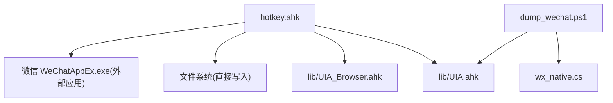
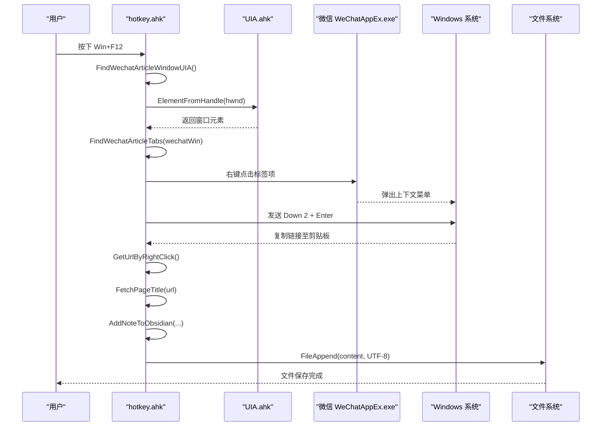
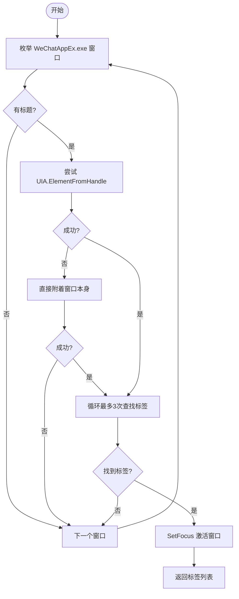
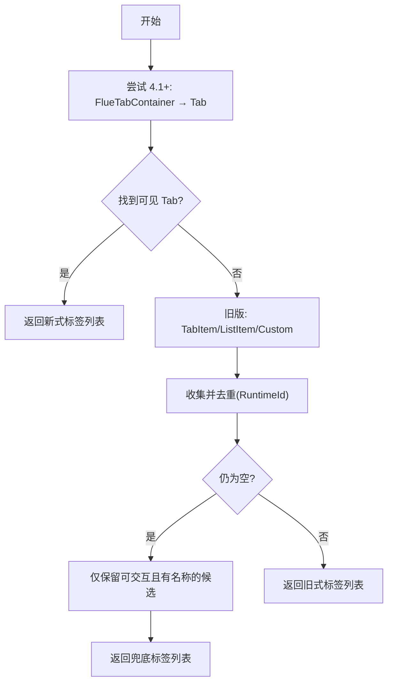
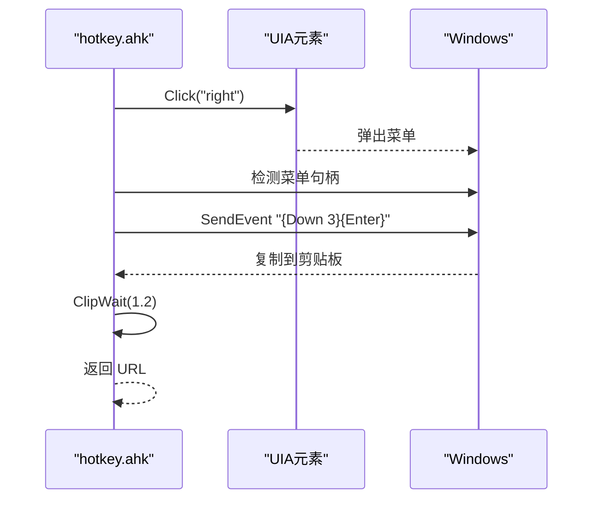
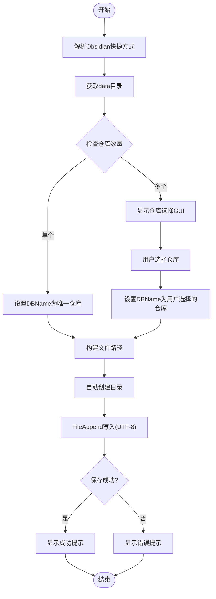
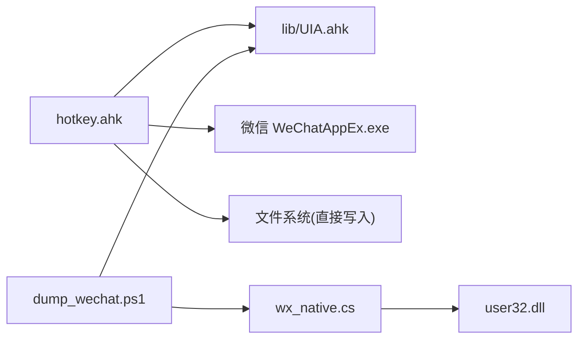

# 微信文章处理系统

<cite>
**本文引用的文件**
- [hotkey.ahk](file://hotkey.ahk)
- [dump_wechat.ps1](file://dump_wechat.ps1)
- [wx_native.cs](file://wx_native.cs)
- [UIA.ahk](file://lib/UIA.ahk)
- [UIA_Browser.ahk](file://lib/UIA_Browser.ahk)
</cite>

## 更新摘要
**已进行的变更**
- Obsidian集成功能从obsidian:// URI协议改为直接FileAppend文件写入
- 新增自动目录创建功能
- 添加UTF-8编码支持
- 增强错误处理和用户反馈机制
- 解决了长内容保存失败问题

## 目录
1. [简介](#简介)
2. [项目结构](#项目结构)
3. [核心组件](#核心组件)
4. [架构总览](#架构总览)
5. [详细组件分析](#详细组件分析)
6. [依赖关系分析](#依赖关系分析)
7. [性能考虑](#性能考虑)
8. [故障排查指南](#故障排查指南)
9. [结论](#结论)
10. [附录](#附录)

## 简介
本仓库实现了一个"微信文章处理系统"，通过 AutoHotkey v2 脚本与 UI Automation（UIA）技术，自动定位微信（WeChatAppEx.exe）中已打开的公众号文章标签页，提取标题与链接，并以 Markdown 格式追加到 Obsidian 笔记库中。同时提供 PowerShell + C# 辅助工具用于转储微信 UIA 树，便于调试和适配不同微信版本。

该系统支持：
- 多版本微信 UIA 结构兼容（3.9、4.1+）
- 自动发现并激活含文章选项卡的窗口
- 右键菜单复制链接、抓取页面 <title> 作为标题
- **直接文件写入Obsidian** - 绕过URI长度限制，支持超长内容保存
- 自动目录创建与UTF-8编码支持
- 完善的错误处理与用户反馈机制

## 项目结构
- 主脚本 hotkey.ahk：定义热键、UIA 定位、链接抓取、**直接文件写入**等核心逻辑
- dump_wechat.ps1：使用 UIAutomationClient/Types 与 wx_native.cs 枚举微信进程、子窗口类名、发送 WM_GETOBJECT，并输出 UIA 树到 wechat_uia_dump.txt
- wx_native.cs：封装 user32.dll 调用，枚举子窗口、获取类名/标题、发送 WM_GETOBJECT
- lib/UIA.ahk：UI Automation 框架封装，提供元素查找、属性访问、事件等能力
- lib/UIA_Browser.ahk：浏览器自动化扩展（本系统主要使用其基础 UIA 能力）

图表来源
- [hotkey.ahk:1536-1615](file://hotkey.ahk#L1536-L1615)
- [dump_wechat.ps1:1-89](file://dump_wechat.ps1#L1-L89)
- [wx_native.cs:1-25](file://wx_native.cs#L1-L25)
- [UIA.ahk:51-198](file://lib/UIA.ahk#L51-L198)

章节来源
- [hotkey.ahk:1536-1615](file://hotkey.ahk#L1536-L1615)
- [dump_wechat.ps1:1-89](file://dump_wechat.ps1#L1-L89)
- [wx_native.cs:1-25](file://wx_native.cs#L1-L25)
- [UIA.ahk:51-198](file://lib/UIA.ahk#L51-L198)

## 核心组件
- 微信文章窗口定位：FindWechatArticleWindowUIA
- 文章标签页识别：FindWechatArticleTabs
- 链接抓取：GetUrlByRightClick
- 标题抓取：FetchPageTitle / DecodeHtmlEntities
- **Obsidian 集成（直接文件写入）**：AddNoteToObsidian
- 调试工具：dump_wechat.ps1 + wx_native.cs

章节来源
- [hotkey.ahk:1375-1411](file://hotkey.ahk#L1375-L1411)
- [hotkey.ahk:1479-1530](file://hotkey.ahk#L1479-L1530)
- [hotkey.ahk:1638-1665](file://hotkey.ahk#L1638-L1665)
- [hotkey.ahk:1417-1474](file://hotkey.ahk#L1417-L1474)
- [hotkey.ahk:1536-1615](file://hotkey.ahk#L1536-L1615)
- [dump_wechat.ps1:1-89](file://dump_wechat.ps1#L1-L89)
- [wx_native.cs:1-25](file://wx_native.cs#L1-L25)

## 架构总览
系统由"触发层（热键）— 定位层（UIA）— 交互层（模拟右键/剪贴板）— **存储层（直接文件写入）**"组成。PowerShell 工具独立于主流程，用于诊断微信 UIA 树结构与渲染控件。

图表来源
- [hotkey.ahk:1319-1361](file://hotkey.ahk#L1319-L1361)
- [hotkey.ahk:1536-1615](file://hotkey.ahk#L1536-L1615)
- [UIA.ahk:51-198](file://lib/UIA.ahk#L51-L198)

## 详细组件分析

### 微信文章窗口定位（FindWechatArticleWindowUIA）
- 遍历 WeChatAppEx.exe 的所有带标题窗口，跳过无标题渲染/工具窗口
- 优先以 Chromium 辅助功能方式附着窗口元素；若失败则直接附着窗口本身以触发按需 UIA 树构建
- 对微信 4.x 的按需 UIA 树进行短重试（最多 3 次，间隔 200ms），确保可找到标签项
- 成功后激活窗口以便后续右键操作有效

图表来源
- [hotkey.ahk:1375-1411](file://hotkey.ahk#L1375-L1411)

章节来源
- [hotkey.ahk:1375-1411](file://hotkey.ahk#L1375-L1411)

### 文章标签页识别（FindWechatArticleTabs）
- 新版（4.1+）：在 FlueTabContainer 下查找 ClassName="Tab" 的元素，并通过边界矩形过滤可见标签
- 旧版（3.9 等）：按 TabItem / Tab 容器内的 ListItem/Custom 收集候选
- 兜底策略：当连 Tab 容器也变为 Custom 时，仅保留可交互且有名称的候选
- 去重：基于 RuntimeId 避免重复添加

图表来源
- [hotkey.ahk:1479-1530](file://hotkey.ahk#L1479-L1530)

章节来源
- [hotkey.ahk:1479-1530](file://hotkey.ahk#L1479-L1530)

### 链接抓取（GetUrlByRightClick）
- 对目标 UIA 元素执行右键点击
- 等待上下文菜单出现（类 #32768），必要时短暂休眠
- 发送键盘导航（向下三次 + 回车）选择"复制链接"
- 等待剪贴板更新并返回 URL

图表来源
- [hotkey.ahk:1638-1665](file://hotkey.ahk#L1638-L1665)

章节来源
- [hotkey.ahk:1638-1665](file://hotkey.ahk#L1638-L1665)

### 标题抓取（FetchPageTitle / DecodeHtmlEntities）
- 使用 WinHttpRequest 获取网页 HTML，超时控制合理
- 正则匹配 msg_title → og:title → twitter:title → <title> 优先级顺序
- 去除多余空白并解码 HTML 实体
- 若失败返回空字符串，由上层回退到 UIA Name 或序号

章节来源
- [hotkey.ahk:1417-1474](file://hotkey.ahk#L1417-L1474)

### Obsidian 集成（AddNoteToObsidian - 直接文件写入）
**重大改进**：从 obsidian:// URI 协议改为直接 FileAppend 文件写入

- 自动解析 Obsidian 快捷方式，定位数据目录 data
- 单仓库直接写入；多仓库弹出 GUI 选择
- **直接文件路径构造**：vaultPath + parentDir + noteName + .md
- **自动目录创建**：SplitPath + DirCreate 确保目标目录存在
- **UTF-8 编码支持**：FileAppend(..., "UTF-8") 确保中文正确保存
- **超长内容支持**：绕过 URI 长度限制，支持 40+ 条文章的批量保存
- **用户反馈机制**：ToolTip 显示保存进度和结果
- **错误处理**：try-catch 捕获保存异常并显示错误信息

图表来源
- [hotkey.ahk:1536-1615](file://hotkey.ahk#L1536-L1615)

章节来源
- [hotkey.ahk:1536-1615](file://hotkey.ahk#L1536-L1615)

### 调试工具（dump_wechat.ps1 + wx_native.cs）
- 枚举微信进程，收集顶层窗口
- 列出每个窗口的子窗口类名与标题，针对 Chrome_RenderWidgetHostHWND 发送 WM_GETOBJECT
- 重新遍历 ControlView 树，输出到 wechat_uia_dump.txt，便于定位 UIA 节点变化

章节来源
- [dump_wechat.ps1:1-89](file://dump_wechat.ps1#L1-L89)
- [wx_native.cs:1-25](file://wx_native.cs#L1-L25)

## 依赖关系分析
- hotkey.ahk 依赖 lib/UIA.ahk 提供的 UIA 能力（元素查找、属性访问、事件等）
- 通过 Windows API（user32）间接与微信进程交互（右键、菜单、剪贴板）
- **直接文件系统操作**：FileAppend 直接写入 Markdown 文件，无需 Obsidian URI 协议
- dump_wechat.ps1 依赖 UIAutomationClient/Types 与 wx_native.cs（C# 封装 user32）

图表来源
- [hotkey.ahk:1536-1615](file://hotkey.ahk#L1536-L1615)
- [dump_wechat.ps1:1-89](file://dump_wechat.ps1#L1-L89)
- [wx_native.cs:1-25](file://wx_native.cs#L1-L25)
- [UIA.ahk:51-198](file://lib/UIA.ahk#L51-L198)

章节来源
- [hotkey.ahk:1536-1615](file://hotkey.ahk#L1536-L1615)
- [dump_wechat.ps1:1-89](file://dump_wechat.ps1#L1-L89)
- [wx_native.cs:1-25](file://wx_native.cs#L1-L25)
- [UIA.ahk:51-198](file://lib/UIA.ahk#L51-L198)

## 性能考虑
- 窗口枚举与 UIA 附着：仅针对 WeChatAppEx.exe 且跳过无标题窗口，减少无效遍历
- 按需 UIA 树构建：对微信 4.x 采用短重试（≤600ms），避免长时间阻塞
- 可见性过滤：通过边界矩形判断标签是否可见，减少不可用项的处理开销
- 网络请求超时：FetchPageTitle 设置合理超时，防止卡死
- 剪贴板等待：ClipWait 限制最大等待时间，提升响应速度
- **直接文件写入**：绕过 URI 协议开销，显著提升长内容保存性能

## 故障排查指南
- 未找到文章选项卡
  - 确认已在微信中打开至少一篇公众号文章
  - 检查 WeChatAppEx.exe 是否运行，且存在带标题的窗口
  - 使用 dump_wechat.ps1 输出 wechat_uia_dump.txt，核对 UIA 树结构是否与预期一致
- 链接抓取失败
  - 检查上下文菜单是否弹出（类 #32768）
  - 确认"复制链接"菜单项顺序与键盘导航一致
  - 验证剪贴板是否在限定时间内更新
- 标题为空
  - 检查网页是否能正常访问（WinHttpRequest 状态码）
  - 确认 <title> 是否存在并可被正则匹配
- **Obsidian 文件写入失败**
  - 确认 Obsidian 快捷方式存在且可解析
  - 多仓库场景需选择正确的 vault
  - 检查文件系统权限是否允许写入
  - 验证目标目录是否存在且可写
  - 检查磁盘空间是否充足

章节来源
- [hotkey.ahk:1319-1361](file://hotkey.ahk#L1319-L1361)
- [dump_wechat.ps1:1-89](file://dump_wechat.ps1#L1-L89)

## 结论
该微信文章处理系统通过稳健的 UIA 定位与多版本兼容策略，实现了从微信文章标签页到 Obsidian 笔记的一键化采集与归档。**最新的直接文件写入方案彻底解决了长内容保存失败的问题**，通过绕过 URI 协议限制、支持 UTF-8 编码、自动目录创建和完善错误处理，显著提升了系统的稳定性和用户体验。配合 PowerShell/C# 调试工具，可有效应对微信版本升级带来的 UIA 结构变化。整体方案具备高可用性、易维护性与良好的用户体验。

## 附录
- 热键说明：Win+F12 触发微信文章采集；Alt+` 可将剪贴板内容追加到 Obsidian 笔记
- **输出位置**：Obsidian 仓库下的"微信公众号文章/YYYY-MM-DD.md"文件（直接文件写入）
- **文件格式**：UTF-8 编码的 Markdown 文件
- 调试输出：wechat_uia_dump.txt（位于脚本目录）