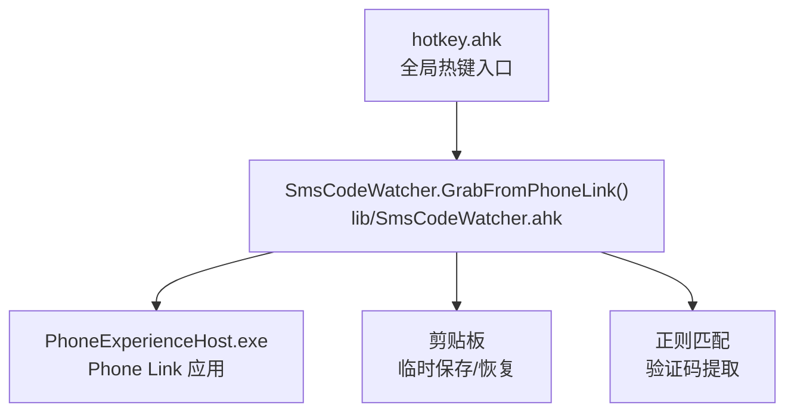
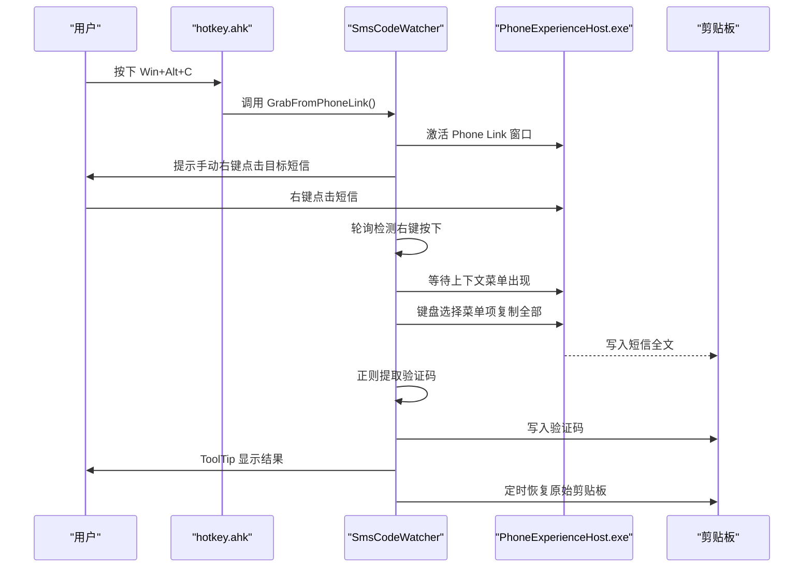
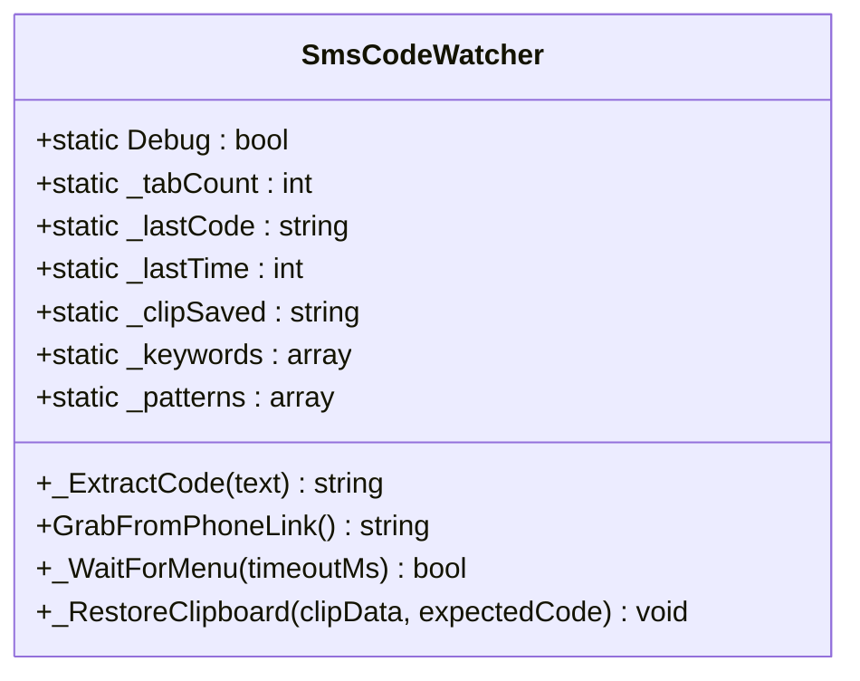
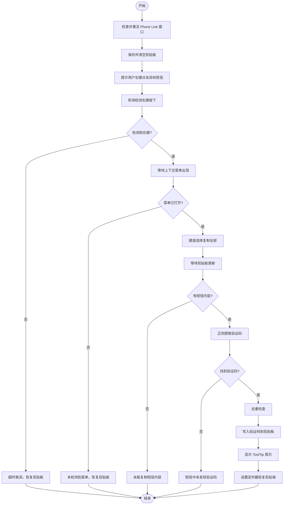
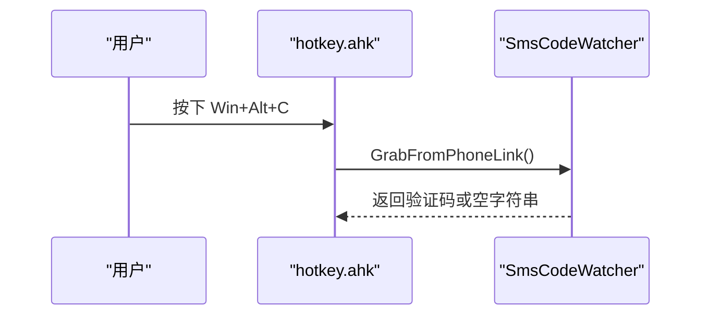
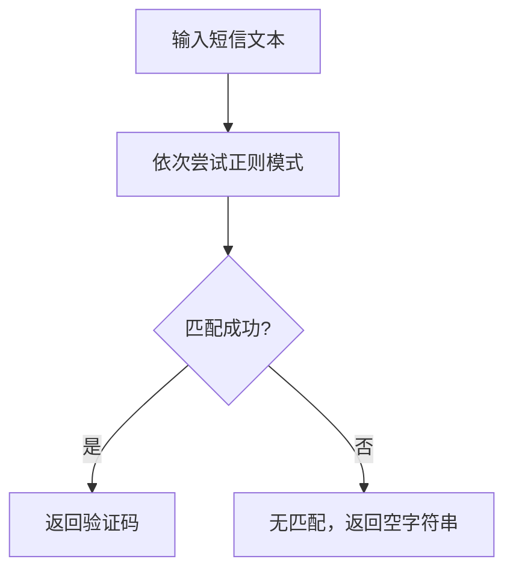
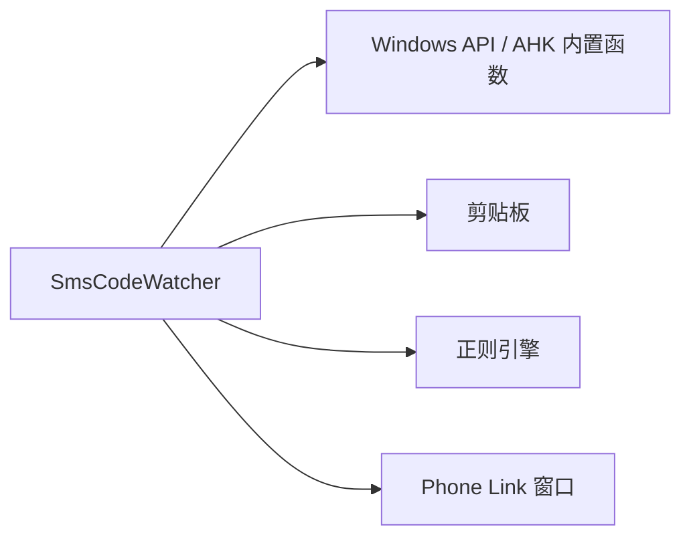

# SMS验证码提取系统

<cite>
**本文引用的文件**   
- [lib/SmsCodeWatcher.ahk](file://lib/SmsCodeWatcher.ahk)
- [hotkey.ahk](file://hotkey.ahk)
- [lib/UIA.ahk](file://lib/UIA.ahk)
- [README.md](file://README.md)
</cite>

## 目录
1. [引言](#引言)
2. [项目结构](#项目结构)
3. [核心组件](#核心组件)
4. [架构总览](#架构总览)
5. [详细组件分析](#详细组件分析)
6. [依赖关系分析](#依赖关系分析)
7. [性能与稳定性考量](#性能与稳定性考量)
8. [故障排查指南](#故障排查指南)
9. [结论](#结论)

## 引言
本仓库是一个基于 AutoHotkey v2 的自动化脚本集合，提供热键、应用启动、浏览器工具集成等能力。本次文档聚焦“SMS 验证码提取系统”，其目标是在 Windows Phone Link（PhoneExperienceHost.exe）中主动抓取第一条短信中的验证码并写入剪贴板，供后续自动填充或粘贴使用。

该系统的核心设计是：通过热键触发，激活 Phone Link 窗口，等待用户右键点击目标短信后自动选择菜单项复制整条短信，再用正则表达式从短信文本中提取验证码，最后将验证码写入剪贴板并在一段时间后恢复原剪贴板内容。

## 项目结构
与 SMS 验证码提取直接相关的文件如下：
- lib/SmsCodeWatcher.ahk：验证码提取的核心类与流程实现
- hotkey.ahk：全局热键定义，包含 Win+Y 切换 Phone Link、Win+Alt+C 触发验证码提取
- lib/UIA.ahk：UI Automation 库，当前验证码流程未直接使用 UIA 元素定位，但作为通用 UIA 能力保留
- README.md：项目简要说明

图表来源
- [hotkey.ahk:295-304](file://hotkey.ahk#L295-L304)
- [lib/SmsCodeWatcher.ahk:52-186](file://lib/SmsCodeWatcher.ahk#L52-L186)

章节来源
- [README.md:1-2](file://README.md#L1-L2)
- [hotkey.ahk:295-304](file://hotkey.ahk#L295-L304)

## 核心组件
- SmsCodeWatcher 类：封装验证码提取全流程，包括窗口激活、右键事件监听、上下文菜单检测、短信复制、正则提取、去重与剪贴板恢复。
- 热键绑定：
  - Win+Y：切换 Phone Link 窗口（仅激活/最小化）
  - Win+Alt+C：触发验证码提取全流程

关键职责划分：
- hotkey.ahk 负责热键注册与调用 SmsCodeWatcher.GrabFromPhoneLink()
- SmsCodeWatcher.ahk 负责具体交互逻辑与验证码处理
- UIA.ahk 作为通用 UIA 库存在，当前验证码流程未直接依赖其元素定位能力

章节来源
- [lib/SmsCodeWatcher.ahk:10-32](file://lib/SmsCodeWatcher.ahk#L10-L32)
- [hotkey.ahk:295-304](file://hotkey.ahk#L295-L304)

## 架构总览
验证码提取的整体时序如下：

图表来源
- [hotkey.ahk:303-304](file://hotkey.ahk#L303-L304)
- [lib/SmsCodeWatcher.ahk:52-186](file://lib/SmsCodeWatcher.ahk#L52-L186)

## 详细组件分析

### SmsCodeWatcher 类
该类实现了完整的验证码抓取流程，主要方法包括：
- _ExtractCode(text)：按顺序尝试多个正则模式，返回第一个匹配的验证码
- GrabFromPhoneLink()：主流程，包含窗口激活、右键监听、菜单检测、短信复制、验证码提取、去重、剪贴板恢复
- _WaitForMenu(timeoutMs)：检测 WinAppSDK/WinUI 3 上下文菜单是否出现
- _RestoreClipboard(clipData, expectedCode)：在用户未修改剪贴板时恢复原始内容

图表来源
- [lib/SmsCodeWatcher.ahk:10-32](file://lib/SmsCodeWatcher.ahk#L10-L32)
- [lib/SmsCodeWatcher.ahk:39-47](file://lib/SmsCodeWatcher.ahk#L39-L47)
- [lib/SmsCodeWatcher.ahk:52-186](file://lib/SmsCodeWatcher.ahk#L52-L186)
- [lib/SmsCodeWatcher.ahk:195-208](file://lib/SmsCodeWatcher.ahk#L195-L208)
- [lib/SmsCodeWatcher.ahk:213-222](file://lib/SmsCodeWatcher.ahk#L213-L222)

#### 主流程流程图

图表来源
- [lib/SmsCodeWatcher.ahk:52-186](file://lib/SmsCodeWatcher.ahk#L52-L186)

章节来源
- [lib/SmsCodeWatcher.ahk:52-186](file://lib/SmsCodeWatcher.ahk#L52-L186)

### 热键绑定与入口
- Win+Y：切换 Phone Link 窗口，使用 ToggleWindow 函数
- Win+Alt+C：直接调用 SmsCodeWatcher.GrabFromPhoneLink()

图表来源
- [hotkey.ahk:295-304](file://hotkey.ahk#L295-L304)

章节来源
- [hotkey.ahk:295-304](file://hotkey.ahk#L295-L304)

### 正则提取逻辑
验证码提取采用多模式回退策略，优先匹配中文关键词（如“验证码”），其次匹配英文关键词（如 “verification code”），最终回退到通用 “code is ...” 模式。若命中则返回捕获组中的数字串。

图表来源
- [lib/SmsCodeWatcher.ahk:27-32](file://lib/SmsCodeWatcher.ahk#L27-L32)
- [lib/SmsCodeWatcher.ahk:39-47](file://lib/SmsCodeWatcher.ahk#L39-L47)

章节来源
- [lib/SmsCodeWatcher.ahk:27-47](file://lib/SmsCodeWatcher.ahk#L27-L47)

## 依赖关系分析
- SmsCodeWatcher 依赖系统 API：
  - WinExist/WinActivate/WinWaitActive：窗口管理
  - ToolTip/SetTimer：用户反馈与延时任务
  - GetAsyncKeyState：右键状态轮询
  - SendEvent/Send：模拟键盘操作
  - ClipboardAll/A_Clipboard/ClipWait：剪贴板读写
  - RegExMatch：正则匹配
- 不依赖 UIA 元素定位：当前实现通过键盘交互和窗口类名检测菜单，避免 WinUI 3 树遍历开销

图表来源
- [lib/SmsCodeWatcher.ahk:52-186](file://lib/SmsCodeWatcher.ahk#L52-L186)

章节来源
- [lib/SmsCodeWatcher.ahk:52-186](file://lib/SmsCodeWatcher.ahk#L52-L186)

## 性能与稳定性考量
- 窗口激活与布局稳定：首次启动 Phone Link 后增加额外等待时间，确保 UI 就绪
- 右键监听轮询间隔：50ms，平衡响应速度与 CPU 占用
- 菜单检测：同时检测 WinAppSDK 弹出层宿主窗口与通用 CoreWindow 类，提高兼容性
- 剪贴板保护：操作前保存完整剪贴板数据，失败路径均恢复；成功后仅在用户未修改时恢复
- 去重机制：60 秒内相同验证码不重复触发，避免误报
- 调试输出：Debug 开关控制 OutputDebug 输出，便于诊断但不影响生产行为

优化建议：
- 可考虑将右键轮询改为更轻量的钩子或事件驱动方式（需权衡复杂度）
- 菜单检测可增加更多候选窗口类名以适配不同系统版本
- 正则模式可按业务需求扩展，但应保持优先级明确

[本节为通用指导，不直接分析具体文件]

## 故障排查指南
常见问题与处理建议：
- Phone Link 未响应：检查进程是否存在，必要时重新启动 ms-phone: 协议
- 无法激活 Phone Link：确认窗口标题匹配正确，检查权限与焦点
- 未检测到右键菜单：确认用户确实右键点击了短信条目，检查菜单类名匹配
- 复制超时：检查剪贴板访问权限，确认短信内容非空
- 短信中未发现验证码：检查短信格式是否符合预设正则模式，必要时调整 _patterns
- 剪贴板未恢复：确认用户未在 30 秒内修改剪贴板，或手动恢复

章节来源
- [lib/SmsCodeWatcher.ahk:58-73](file://lib/SmsCodeWatcher.ahk#L58-L73)
- [lib/SmsCodeWatcher.ahk:106-127](file://lib/SmsCodeWatcher.ahk#L106-L127)
- [lib/SmsCodeWatcher.ahk:136-151](file://lib/SmsCodeWatcher.ahk#L136-L151)
- [lib/SmsCodeWatcher.ahk:213-222](file://lib/SmsCodeWatcher.ahk#L213-L222)

## 结论
SMS 验证码提取系统通过热键驱动 Phone Link 应用，结合键盘交互与正则匹配，实现了稳定、低开销的验证码抓取流程。相比之前的 toast 监听方案，新方案避免了 UIA 事件不可靠的问题，并通过纯键盘操作与窗口类名检测提升了兼容性与性能。未来可根据实际使用场景进一步优化菜单检测与正则模式，以提升准确率与鲁棒性。

[本节为总结性内容，不直接分析具体文件]